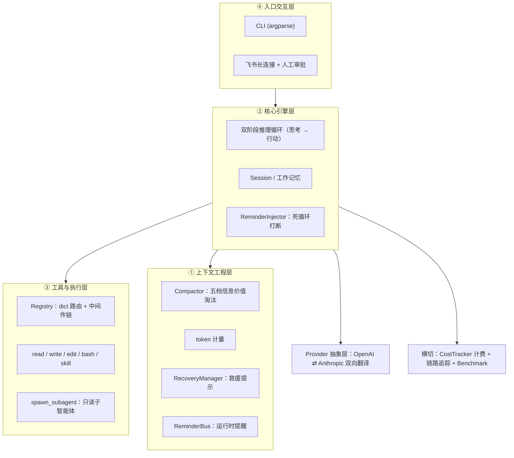

# tiny-claw

**一个最小可用的自主编码 Agent 运行时（Python）。**

不追求功能全，追求**可控**——
上下文不撑爆、失败能自愈、跑偏能打断、越权能拦住。

| | |
|---|---|
| 语言 / 运行时 | Python 3.12+（asyncio） |
| 代码规模 | 6206 行源码 / 44 个文件 |
| 测试 | **4151 行 / 265 个用例全绿** |
| 端到端评测 | 4 个真实任务用例，**4/4 通过**，成本 ¥0.0754（2026-09-28） |
| 模型接入 | DeepSeek（OpenAI 协议）+ Anthropic Messages 协议 |
| 入口 | CLI + 飞书机器人（长连接） |

---

## 它解决什么问题

一个能自己改代码的 Agent，真正的难点不在"调模型"，而在这四件事：

| 问题 | 本项目的做法 |
|---|---|
| **上下文会撑爆** | 按**信息价值**分五档渐进淘汰（不是按时间一刀切）；长文件三层防御（行号分段 / 输出卸载 / 硬截断） |
| **失败了会卡死** | 错误码标准化 → 表驱动救援提示 → 调用指纹检测死循环；**失败是返回值，不是异常** |
| **会跑偏 / 跑不完** | System Reminders 运行时回灌（上下文压力、剩余轮数），带冷却与限流 |
| **会越权操作** | Registry 中间件拦截高危命令，挂起等待飞书人工审批（fail-closed） |

## 架构



**分层原则**：引擎只认内部 Schema（`Message` / `ToolCall` / `ToolDefinition`），
不知道世界上存在 OpenAI 还是 Anthropic——协议差异全部由 Provider 层双向翻译。

## 快速开始

```bash
git clone <repo> && cd python-tiny-claw

# 1. 装依赖（可编辑安装，装完会提供 tiny-claw 命令）
python -m venv .venv && source .venv/bin/activate
pip install -e ".[dev]"

# 2. 配密钥（照 .env.example 复制，改两行即可）
cp .env.example .env
#   DEEPSEEK_API_KEY=sk-xxx
#   TINY_CLAW_MODEL=deepseek-v4-flash

# 3. 跑一个任务
tiny-claw -p "统计 src 目录下每个模块的代码行数，写进 code-stats.md" -d ./workspace
```

不装也能跑（根目录保留了兼容入口）：

```bash
python main.py -p "..." -d ./workspace
```

### 两种运行模式

```bash
# CLI：人在终端旁边看着，直接跑
tiny-claw -p "重构 src/tiny_claw/context 模块" -d ./workspace

# 飞书：AgentOps 模式，高危操作挂起等人工批复
tiny-claw --mode feishu -d ./workspace
# 命中高危命令时机器人会发：请回复 approve <task_id> 或 reject <task_id>
```

## 配置

所有常量与凭据的唯一来源是 `src/tiny_claw/config.py`，按键名从项目根 `.env` 读取
（`override=False`，因此 shell 里 `export` 的值优先，方便 CI 覆盖）。

- **凭据运行时读取**：支持轮换与测试打桩
- **调参常量 import 快照**：进程内不会中途变化
- `TINY_CLAW_DISABLE_DOTENV=1` 可禁用 `.env` 加载（单测隔离用）

`.env` **不入库**，仓库里只有 `.env.example`（含每个常量的取值理由与约束注释）。

## 测试

```bash
pytest -q          # 133 passed
```

覆盖范围：双协议翻译对照（20）· 上下文治理（29）· 配置与工具口径（25）· 长文件读取（20）·
MCP（44）· edit_file（21）· 评测插桩（20）· 技能与 Prompt 组装（17）· System Reminders（14）·
Registry 中间件链（11）· 引擎主循环（9）· write_file（9）· 工具并发（3），共 265 个用例。

夹具里包含真实 140KB 日志与"卸载后读回"用例——用来证明卸载机制不会制造死循环。

## 评测

```bash
python run_benchmark.py                        # 跑基线（带金额 + token 双轨预算止损）
python tools/replay_thresholds.py              # 离线重放：调阈值零 API 成本
```

设计思路是**一次录制、离线重放**：跑分时用三个插桩代理录下
「本地估算 vs 真实计费 token」「工具输出体积分布」「每轮压缩前的上下文快照」，
之后调参在本地网格搜索，不再消耗 API 额度。

最近一次跑分（2026-09-28）：**4 个用例全部通过，成本 ¥0.0754**
（编辑 / 代码生成 / 大文件阅读 / 多步整合）。

校准闭环有前后对比 —— 这也是「先计量、再校准、最后才调参」的证据：

| | 旧估算系数 | 改为 CJK 感知后 |
|---|---|---|
| 回归斜率（最小二乘拟合） | **1.858**（系统性低估 86%） | **0.959**（≈1，基本吻合） |
| 整体比值「真实 prompt ÷ 本地估算」 | 3.05 | **1.34** |

> **阈值 `16000 / 32000` 是等比重标定（×4）的工程裁量**，不是重放推出来的最优解：
> 重放显示所有档位的触发率都是 0%（语料峰值 est 仅 3010），脚本推荐的「够用最小档」是 8000。
>
> 报告在 `reports/`；原始 trace 与历史归档未包含在公开版，仓库只保留汇总报告。

## 目录结构

```
src/tiny_claw/
├── cli.py            # 入口（CLI / 飞书）
├── config.py         # 配置唯一来源
├── engine/           # 双阶段推理循环、会话、死循环打断、Reporter
├── context/          # 组装、压缩、token 计量、错误自愈、提醒总线
├── tools/            # Registry + 内置工具 + 子智能体
├── mcp/              # MCP 客户端：配置加载 / 连接与发现 / 适配与注册 / 分级审批
├── provider/         # OpenAI / Anthropic 双协议 + 抽象基类
├── feishu/           # 长连接 + 人工审批回路
└── eval/             # Benchmark + 插桩层
```

## 设计取舍与已知边界

说清楚哪里不行，比宣称什么都能做更可信：

| 边界 | 现状 |
|---|---|
| 慢思考（双阶段推理） | 有 A/B 实测（`--thinking` 开关）：**成本 +54%、通过率无差异**；设计理由是「先想清楚再动手」，尚未被数据证实 |
| 子智能体的只读约束 | 是**意图层不是强制层**：`read_only_registry` 只挂只读工具，但 bash 本身仍可写文件；且它没有挂审批中间件 |
| Provider 层错误 | 429 限流 / 超时**尚未纳入错误码体系**，会直接冒泡终止循环 |
| bash 大输出 | 只对 `read_file` 做了输出卸载，bash 的 `cat` / `ls` 大输出仍会撑上下文 |
| 卸载后的重复读取 | 卸载返回成功态，指纹检测统计不到，反复读同一文件不告警 |
| 测试缺口 | 三处已知空白已于 2026-09-28 补齐（`edit_file` 四级匹配 / Registry 中间件链 / 引擎主循环，共 +41 用例） |
| MCP 客户端 | **端到端已验证**（2026-09-29）：模型成功调用 `mcp__secure-filesystem-server__list_directory` 并拿到真实目录内容。审批按 server 的 `approval` 分级，默认最保守。⚠️ 实测的坑：**`npx -y` 启动的 server 握手超时，换 `node` 直连即正常**（同一份代码，详见 plan §13.6），配置模板已改为 node 直连 |
| 打包 | `README` 与 entry point 刚补齐；尚未做发布流程验证 |

## 超出基础架构的部分

以下能力是在「能跑」之外自己加的：**token 计量与 benchmark 校准**、
**System Reminders 运行时回灌**、**离线重放调参**（调阈值零 API 成本）、
**Anthropic Messages 协议支持**（一套引擎两套协议做同模型对照实验）、
**MCP 客户端接入**（连接 / 发现 / 适配 / 注册 / 分级审批 / 模型调用，**端到端已验证**）。
